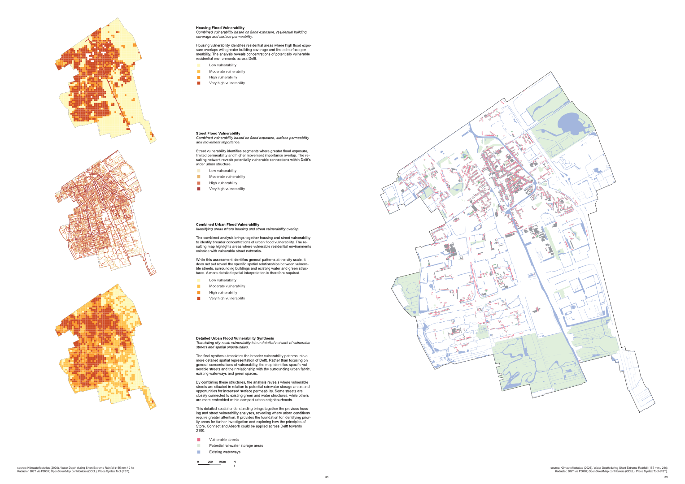
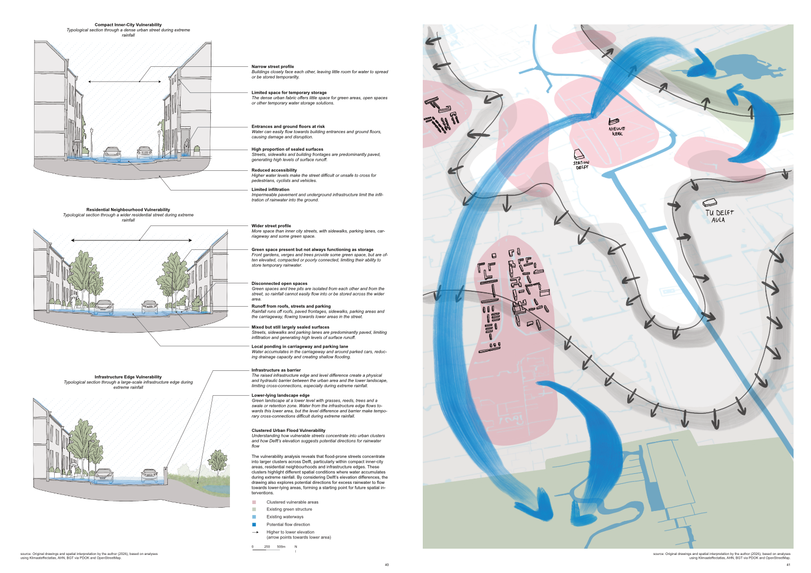
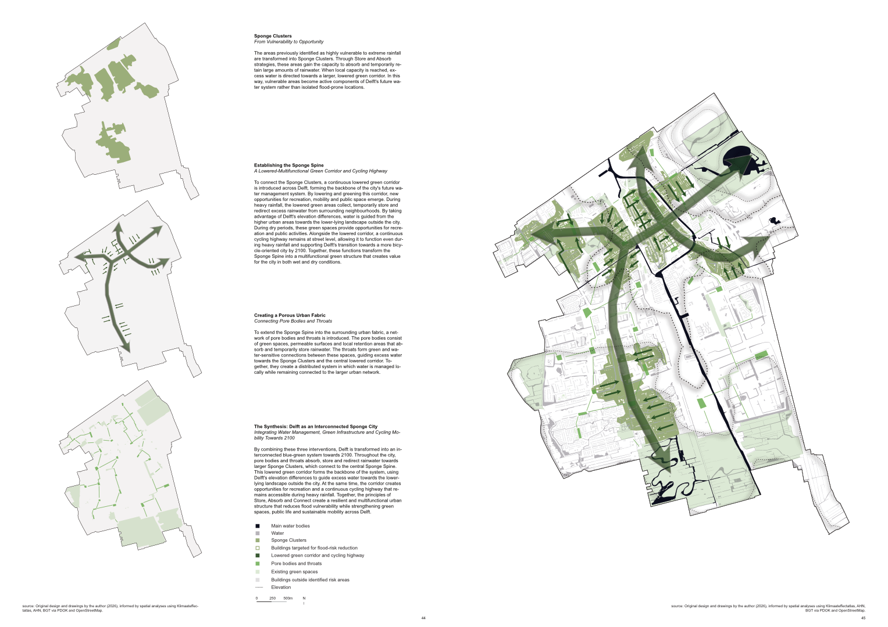
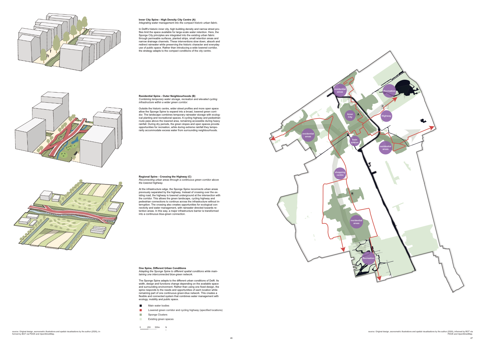
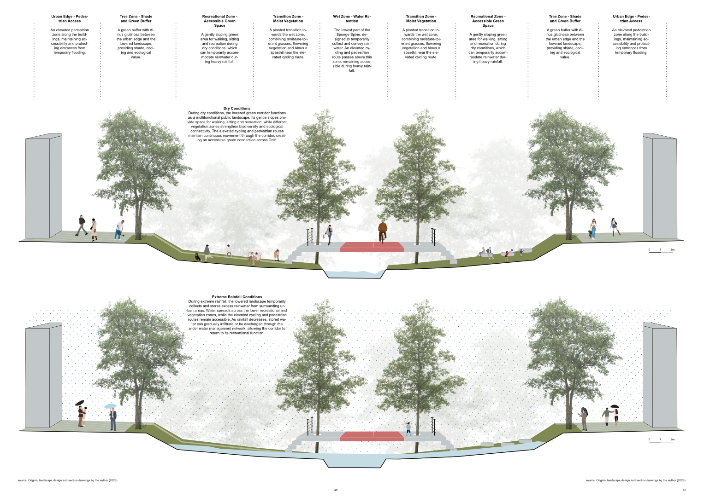
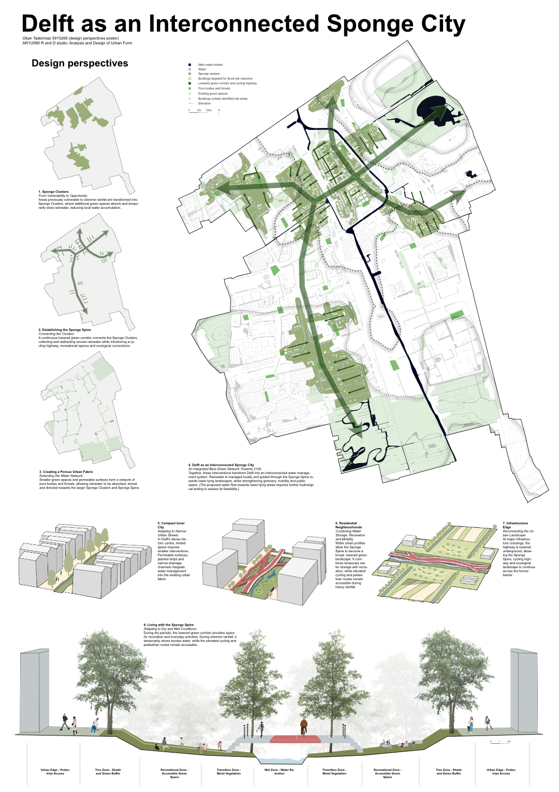

# Delft as an Interconnected Sponge City

*Master of Science Urbanism — TU Delft | 2026*

How can Delft adapt to increasingly extreme rainfall towards 2100? This project explores how streets, public spaces and green infrastructure can work together as a connected urban water system. Through spatial analyses of flood exposure, surface permeability, housing and movement networks, vulnerable areas were identified across the city. The findings formed the basis for a strategy that combines water management with ecological connectivity, recreation and cycling.

The proposal introduces three complementary interventions: **Sponge Clusters**, where vulnerable areas are transformed into places that absorb and temporarily store rainfall; a **Sponge Spine**, a continuous lowered green corridor that collects and guides excess water towards lower-lying landscapes; and a **Porous Urban Fabric**, a network of smaller green spaces and permeable connections that links neighbourhoods to the larger system. An elevated cycling route remains accessible during heavy rainfall, while the lowered landscape provides recreational space during dry conditions.

The strategy adapts to different urban settings. In the compact historic centre, interventions respond to narrow streets and existing buildings. In residential neighbourhoods, wider profiles allow more space for temporary storage and recreation. At the infrastructure edge, the corridor crosses above a lowered highway, reconnecting green landscapes on either side.

  <figure><figcaption>Urban flood vulnerability analysis</figcaption></figure>
  <figure><figcaption>Urban conditions and opportunities</figcaption></figure>
  <figure><figcaption>Sponge City design strategy</figcaption></figure>
  <figure><figcaption>Adapting the Sponge Spine to different urban conditions</figcaption></figure>
  <figure><figcaption>Living with the Sponge Spine: dry and rainy conditions</figcaption></figure>
  <figure><figcaption>Final design poster</figcaption></figure>

  <button type="button" class="delft-close" aria-label="Close">×</button>
  <button type="button" class="delft-prev" aria-label="Previous image">❮</button>
  
  <button type="button" class="delft-next" aria-label="Next image">❯</button>

